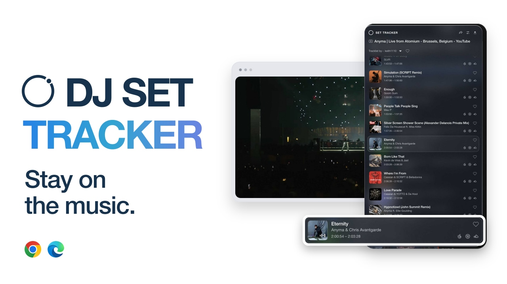
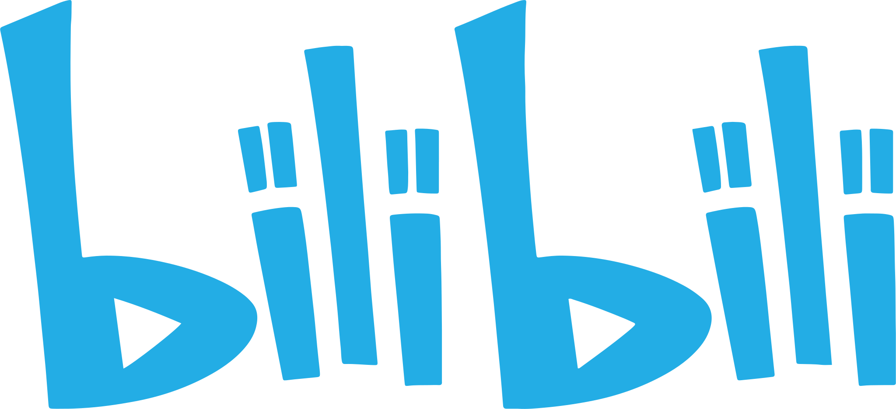

**English** · [简体中文](README.zh-CN.md)

**A browser extension for watching DJ sets.**

  <picture><source media="(prefers-color-scheme: dark)" srcset="assets/youtube-dark.svg"></picture>
  &nbsp;&nbsp;&nbsp;&nbsp;
  

<a href="https://chromewebstore.google.com/detail/set-tracker/jdpgcgcbigjpgfheaimikbkmgdpkaaod"><picture><source media="(prefers-color-scheme: dark)" srcset="assets/button-chrome-dark.png"></picture></a>
&nbsp;
<a href="https://microsoftedge.microsoft.com/addons/detail/set-tracker/dicipdfdgkemhcflmngpgojnhoialnoj"><picture><source media="(prefers-color-scheme: dark)" srcset="assets/button-edge-dark.png"></picture></a>
&nbsp;
<a href="https://github.com/BlackiePiggy/DJ-Set-Tracker/releases/latest/download/DJ-Set-Tracker-Chrome-Edge.zip"><picture><source media="(prefers-color-scheme: dark)" srcset="assets/button-download-dark.png"></picture></a>

[Website](https://djsettracker.live/?lang=en) &nbsp; · &nbsp; [Guide](docs/GETTING-STARTED.md) &nbsp; · &nbsp; [Releases](https://github.com/BlackiePiggy/DJ-Set-Tracker/releases) &nbsp; · &nbsp; [Feedback](https://github.com/BlackiePiggy/DJ-Set-Tracker/issues)

<!-- Native GitHub attachment: keep this URL on its own line for inline playback. -->
https://github.com/user-attachments/assets/b3caa6ef-cdf4-41de-bf08-8c66f4dbcc63

Meet DJ Set Tracker in 56 seconds. · <a href="https://youtu.be/dUOmPjeTa1c">Watch on YouTube ↗</a>

## Your next set starts here

1. **Install.** Choose Chrome or Edge above, or download the latest ZIP.
2. **Put on a set.** Open YouTube or Bilibili in your desktop browser. Click **SET TRACKER** on the right.
3. **Pick a tracklist.** Choose an available version or add one through **Import / Sources**. Press play.

Installing a ZIP? Extract it → enable Developer mode on your browser’s extensions page → **Load unpacked**. [Full installation & update guide →](docs/GETTING-STARTED.md)

## Stay up to date

Store installations receive approved updates through the browser. GitHub ZIP installations need a fresh download, replacement of the original installation folder and a reload. Release timing can differ between channels.

[Get the latest release](https://github.com/BlackiePiggy/DJ-Set-Tracker/releases/latest) · [Read what’s new](https://github.com/BlackiePiggy/DJ-Set-Tracker/releases) · **Watch → Custom → Releases** for release notifications.

Choose **DJ-Set-Tracker-Chrome-Edge.zip**. GitHub’s automatic “Source code” archives are not extension installers. Public releases begin at v0.31.17.

---

[Guide & FAQ](docs/GETTING-STARTED.md) · [Report an issue](https://github.com/BlackiePiggy/DJ-Set-Tracker/issues/new/choose) · [Support](https://djsettracker.live/support) · [Privacy](https://djsettracker.live/privacy)

The official home for DJ Set Tracker announcements, downloads and support. This repository publishes documentation and promotional assets; development source is private. Installable packages are provided through Releases. Built for desktop Chrome / Edge; tracklist coverage and cue accuracy depend on available sources. YouTube, Bilibili and other names and marks belong to their respective owners.
