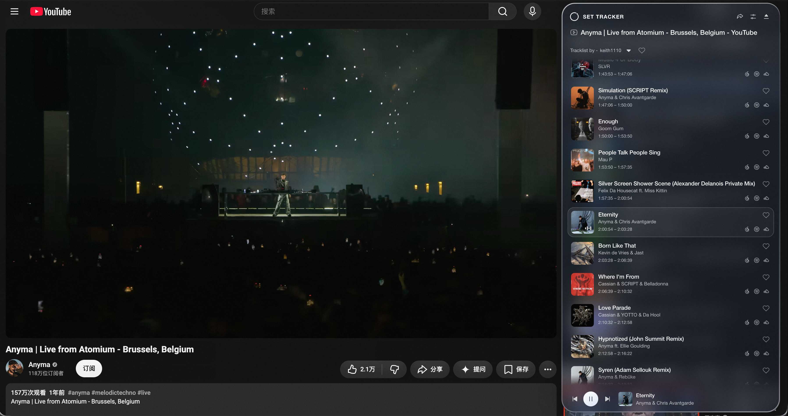

[English](README.md) · **简体中文**

<picture>
  <source media="(prefers-color-scheme: dark)" srcset="assets/header-dark.svg">
  
</picture>

**为观看 DJ Set 而生的浏览器插件。**

  <picture><source media="(prefers-color-scheme: dark)" srcset="assets/youtube-dark.svg"></picture>
  &nbsp;&nbsp;&nbsp;&nbsp;
  

<a href="https://chromewebstore.google.com/detail/set-tracker/jdpgcgcbigjpgfheaimikbkmgdpkaaod"><picture><source media="(prefers-color-scheme: dark)" srcset="assets/button-chrome-dark.png"></picture></a>
&nbsp;
<a href="https://microsoftedge.microsoft.com/addons/detail/set-tracker/dicipdfdgkemhcflmngpgojnhoialnoj"><picture><source media="(prefers-color-scheme: dark)" srcset="assets/button-edge-dark.png"></picture></a>
&nbsp;
<a href="https://github.com/BlackiePiggy/DJ-Set-Tracker/releases/latest/download/DJ-Set-Tracker-Chrome-Edge.zip"><picture><source media="(prefers-color-scheme: dark)" srcset="assets/button-download-dark.png"></picture></a>

[官网](https://djsettracker.live/?lang=zh) &nbsp; · &nbsp; [使用指南](docs/GETTING-STARTED.zh-CN.md) &nbsp; · &nbsp; [更新记录](https://github.com/BlackiePiggy/DJ-Set-Tracker/releases) &nbsp; · &nbsp; [反馈](https://github.com/BlackiePiggy/DJ-Set-Tracker/issues)

<!-- Native GitHub attachment: keep this URL on its own line for inline playback. -->
https://github.com/user-attachments/assets/a55a4b00-c198-474e-9d65-1b06f4f11ff6

56 秒，认识 DJ Set Tracker。 · <a href="https://youtu.be/dUOmPjeTa1c">在 YouTube 观看英文版 ↗</a>

## 沉浸在每一首里

- **跟上现场。** 曲目随视频同步高亮，点击时间点回到那个瞬间。
- **留下发现。** 收藏喜欢的曲目和歌单，继续前往音乐平台探索。
- **整理你的歌单。** 选择已有版本、导入来源，或自己编辑曲目和时间点。

看看它在 YouTube 中的样子

 

## 下一场 Set，从这里开始

1. **安装插件。** 选择上方 Chrome、Edge 商店，或下载最新 ZIP。
2. **打开视频。** 在桌面浏览器播放 YouTube 或 Bilibili 视频，点击右侧 **SET TRACKER**。
3. **选择歌单。** 使用已有歌单，或通过 **导入 / 来源** 添加曲目，开始听。

ZIP 安装：解压 → 扩展管理页开启开发者模式 → 加载已解压的扩展。 [详细安装与更新说明 →](docs/GETTING-STARTED.zh-CN.md)

## 保持更新

商店安装版由浏览器接收已审核的更新；GitHub ZIP 版需下载新包、替换原安装目录并重新加载。两个渠道的发布时间可能不同。

[下载最新版本](https://github.com/BlackiePiggy/DJ-Set-Tracker/releases/latest) · [查看更新记录](https://github.com/BlackiePiggy/DJ-Set-Tracker/releases) · **Watch → Custom → Releases** 订阅发布通知。

请选择 **DJ-Set-Tracker-Chrome-Edge.zip**。GitHub 自动生成的 “Source code” 归档不是插件安装包。公开版本从 v0.31.17 开始。

---

[使用指南与常见问题](docs/GETTING-STARTED.zh-CN.md) · [问题反馈](https://github.com/BlackiePiggy/DJ-Set-Tracker/issues/new/choose) · [支持](https://djsettracker.live/support) · [隐私](https://djsettracker.live/privacy)

DJ Set Tracker 官方宣传、下载与支持仓库，仅公开文档与宣传素材。开发源码不在此发布；安装包通过 Releases 提供。适用于桌面 Chrome / Edge，歌单覆盖与时间点精度取决于可用来源。YouTube、Bilibili 等名称及标识归各自所有者所有。
